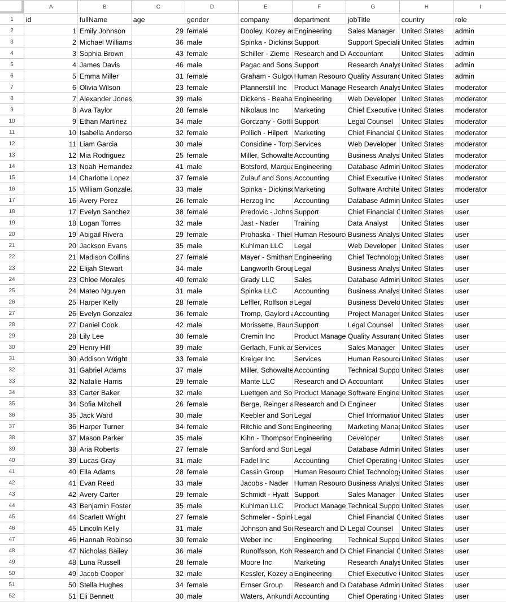
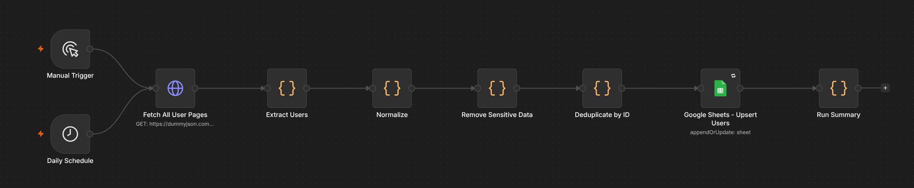

<div align="center">


# API Data Pipeline

**Fetch paginated REST API data, keep an explicit set of fields, and sync records to Google Sheets with n8n.**

[](./LICENSE)
[](https://docs.n8n.io/build/manage-workflows/export-and-import/)
[](#-quickstart)

[Quickstart](#-quickstart) · [Demo](#-demo) · [Sample output](./examples/sample-output.json)

</div>

## ✨ Why API Data Pipeline

A paginated API response needs a consistent shape before it can feed a spreadsheet. This workflow uses the DummyJSON Users API to show how to select columns and update rows by a stable ID across runs.

## 🧩 Features

- Fetch user records in pages of 25, with a cap of 20 requests per run.
- Use an allowlist to keep nine columns and drop source fields such as email and phone before writing to Sheets.
- Keep the first record for each ID within a run and upsert Sheets rows by `id`.
- Start manually or on a daily schedule and inspect a JSON summary after the write.

## 🎬 Demo



## 🚀 Quickstart

1. Import [workflow.json](./workflow.json) into n8n.
2. Create a spreadsheet and paste these tab-separated headers into row 1 of its first tab.

   ```text
   id	fullName	age	gender	company	department	jobTitle	country	role
   ```

3. In **Google Sheets - Upsert Users**, select your Google Sheets credential, replace `PASTE_GOOGLE_SHEET_ID_HERE` with the spreadsheet ID, and confirm the tab and `id` match column.
4. Run **Manual Trigger**. Verify that user rows appear in the sheet and open **Run Summary** to see the write count.

## 📖 Usage

Publish the workflow to enable the **Daily Schedule** at 07:00 in `Europe/Berlin`. Re-running refreshes matching IDs and inserts new ones. Rows whose IDs disappear from the source stay in the sheet.

See an [example row payload](./examples/sample-output.json) and an [example run summary](./examples/run-summary.json).

## 🏗️ Architecture



**Remove Sensitive Data** limits the columns sent to Sheets. Earlier n8n nodes still handle the full API response.

## ⚙️ Configuration

| Setting | Where | Default |
| --- | --- | --- |
| Source endpoint | **Fetch All User Pages** | `https://dummyjson.com/users` |
| Page size and cap | **Fetch All User Pages** | 25 records per page, up to 20 requests |
| Destination tab | **Google Sheets - Upsert Users** | Tab ID `0` |
| Schedule and timezone | **Daily Schedule** and workflow settings | 07:00 daily, `Europe/Berlin` |

## 🛠️ Tech Stack

n8n, JavaScript Code nodes, DummyJSON REST API, and Google Sheets.

## 📄 License

MIT License. See [LICENSE](./LICENSE).

---

<div align="center">
  <sub>Released under the <a href="./LICENSE">MIT License</a>. If this saved you time, a ⭐️ helps others find it.</sub>
</div>
